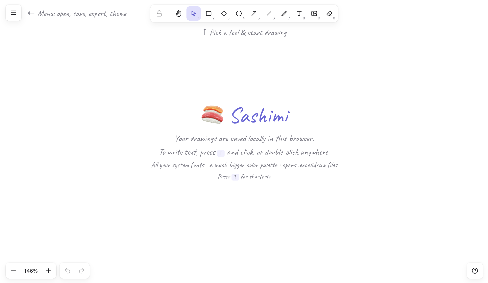

# 🍣 Sashimi

a basic whiteboard that looks like excalidraw/tldraw, but using all the fonts on your system and any color, that's it! (and it's 100% local)



<br>

## Quick start

You can either [use the website]() or run the code yourself, which requires [Bun](https://bun.sh):

```sh
# Clone the repo
git clone https://github.com/JosephBARBIERDARNAL/sashimi.git

# Install it and launch the dev server
cd sashimi && bun install && bun run dev
```

<br>

## Motivation

Excalidraw/tldraw are nice, but their web app lack basic features. The two main features that I don't get why aren't present are:

- being able to pick any color I want
- being able to pick any fonts installed on my machine

that's exactly what `sashimi` brings to the table!

<br>

## License

[MIT](LICENSE)
